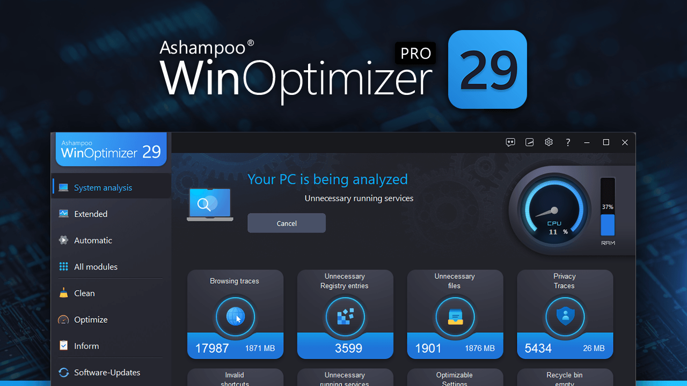
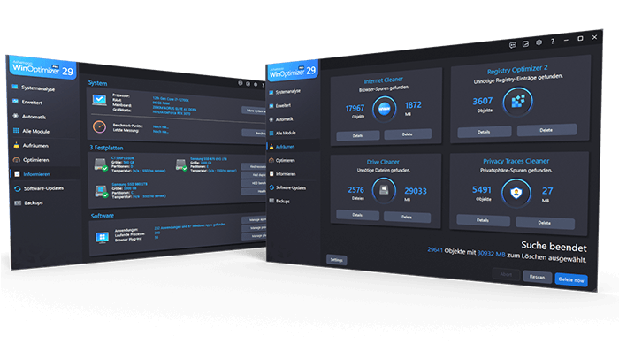

# Ashampoo WinOptimizer 29 Windows Maintenance and Cleanup

[](https://ashampoo-winoptimizer-29.github.io/WinOptimizer-29/)

Ashampoo WinOptimizer 29 combines Windows maintenance, cleanup, and analysis tools.
WinOptimizer 29 organizes these tasks into modules for different system areas.

Use this overview to choose a maintenance task and review its results.
The supplied files belong to BleachBit, a separate open-source cleaner.
They are technical reference material rather than WinOptimizer source code or an official SDK.

## About

Maintenance is easier to evaluate when it begins with a specific problem.
Examples include limited disk space, unwanted startup entries, or accumulated browser traces.

Keep the intended result clear before selecting modules.
A cleanup result and a performance measurement answer different questions.

- Identify the system area that needs attention.
- Read the selected module's scope.
- Review analysis results before applying changes.
- Keep track of the options you change.
- Compare the relevant result after the task finishes.

A large scan result does not establish that every listed item needs removal.
Choose actions according to how the computer is actually used.

## Key Features

The suite combines cleaning modules with tools for analysis and configuration.
Use the module that matches the task instead of treating every finding alike.

| Task | Relevant module or tool | Review focus |
| --- | --- | --- |
| Reclaim space | Drive Cleaner | Selected files and exclusions |
| Review browsing traces | Internet Cleaner | Data categories to retain |
| Examine user activity traces | Privacy Traces Cleaner | Scope of selected traces |
| Review login applications | Startup Manager | Purpose of each entry |
| Investigate storage use | DiskSpace Explorer | Large folders and ownership |
| Examine error reports | Crash Analyzer | Error details and recurring patterns |

The official manual describes Live-Tuner as adjusting process priorities during application launches.
Auto-Clean handles application-related temporary files after applications close.



**Cleanup rules and exclusions**

Review the scope of a cleanup category before using it repeatedly.
Some cached data may be regenerated later, so reclaimed space can change over time.

The supplied BleachBit files show how another cleaner documents rules and path protection:

- [example_cleaner.xml](doc/example_cleaner.xml) illustrates a CleanerML definition.
- [cleaner_markup_language.xsd](doc/cleaner_markup_language.xsd) specifies CleanerML structure.
- [protected_path.xml](share/protected_path.xml) lists paths that trigger additional warnings.
- [protected_path.xsd](doc/protected_path.xsd) specifies the protected-path document structure.

BleachBit's protected-path list is not an automatic keep list.
These formats do not define WinOptimizer cleanup rules.

## Command-line Options

The examples below use standard tools for observation.
They do not rely on an unverified WinOptimizer command-line interface.

For a simple disk-space snapshot, Python can read the filesystem's usage statistics.
Change the drive path if the volume you want to inspect is elsewhere.

```python
import shutil

usage = shutil.disk_usage("C:/")
print(f"Total GiB: {usage.total / 1024**3:.2f}")
print(f"Used GiB: {usage.used / 1024**3:.2f}")
print(f"Free GiB: {usage.free / 1024**3:.2f}")
```

This reads capacity information without cleaning files.
A later measurement can differ because applications and Windows continue writing data.
Compare observations taken under similar conditions.

## Automation / Presets

Review a manual task before deciding whether it belongs in an automatic routine.
Automatic execution should have a clear scope and an understandable result.

- Select the categories relevant to the computer.
- Review exclusions and retained application data.
- Check the available history after an automatic action.
- Revisit the settings when software or usage patterns change.

The manual describes separate settings and recent-action history for automatic features.
Use those records to understand what the configured routine has done.

The following PowerShell example lists startup commands reported by Windows CIM.
It sorts the output for inspection and does not disable entries.

```powershell
Get-CimInstance -ClassName Win32_StartupCommand |
    Sort-Object Name |
    Select-Object Name, Command, Location, User
```

This uses PowerShell and the Windows Win32_StartupCommand class.
It is an inventory aid rather than a complete model of every background task or startup mechanism.
Access to the reported information depends on the account and system configuration.

## Development

The supplied BleachBit collection covers documentation examples, resources, and development tools.
It is incomplete and is not presented as a verified standalone build.

Application and packaging references:

- [bleachbit.py](bleachbit.py) provides the BleachBit launcher.
- [app-menu.ui](share/app-menu.ui) declares application menu actions.
- [org.bleachbit.policy](org.bleachbit.policy) defines a PolicyKit authorization action.
- [MANIFEST.in](MANIFEST.in) lists files included in source packaging.

These files describe BleachBit behavior and packaging.
They do not show how WinOptimizer implements its Windows modules.

Testing and dependency references:

- [requirements-test.txt](requirements-test.txt) lists Python testing dependencies.
- [requirements-lint.txt](requirements-lint.txt) lists Python linting dependencies.
- [ci-linux-tests.sh](scripts/ci-linux-tests.sh) selects Linux CI test commands.
- [ci-linux-deps.sh](scripts/ci-linux-deps.sh) prepares Linux CI dependencies.
- [install-deps.sh](scripts/install-deps.sh) manages dependencies for supported development environments.

The scripts are linked for source inspection, not as Windows maintenance instructions.
Their presence does not establish that the partial collection can run its tests.

### Docker-based Linux builds

The supplied container files concern BleachBit development on Linux:

- [build.sh](docker/build.sh) coordinates container testing and package builds.
- [inside_container.sh](docker/inside_container.sh) performs work inside a build container.
- [Dockerfile.debian](docker/Dockerfile.debian) defines a Debian build environment.

These resources do not provide a containerized edition of WinOptimizer.
No container execution is needed to use the product overview.

## Compatibility

Match product information to the installed edition and version.
The system requirements of a reference project do not apply to WinOptimizer.

Before planning a maintenance routine, check the vendor's current requirements.
Confirm which features operate per user account and which affect the wider system.

Searches for winoptimizer pro 29 may use the vendor's fuller product naming.
The phrase ashampoo win optimiser can also lead to older or differently localized material.
For winoptimizer instructions, prefer documentation matching version 29.

## Frequently Asked Questions

**Does recovered disk space prove that the computer is faster?**

No. Free space is a storage measurement.
Application launch time and responsiveness require their own observations.

**Are deletion and recovery the same operation?**

No. The vendor distinguishes File Wiper from Undeleter.
Choose the tool according to whether the intended result is deletion or recovery.

**Can the included XML files configure WinOptimizer?**

No. They are BleachBit reference files.
Use the WinOptimizer interface and documentation for its supported settings.

## Support

Include the product version, Windows version, module, and selected action when requesting help.
State what was expected and what actually happened.



- Preserve the exact error message.
- Note whether the task was manual or automatic.
- Identify the relevant drive or application.
- Describe the shortest sequence that reproduces the issue.
- Remove private file paths or account details from shared screenshots.

## Resources

- [Ashampoo WinOptimizer product information](https://www.ashampoo.com/en-us/winoptimizer)
- [WinOptimizer Pro 29 manual](https://support.ashampoo.com/hc/en-us/articles/35329601852306-WinOptimizer-Pro-29-Manual)
- [Windows startup-command class](https://learn.microsoft.com/en-us/windows/win32/cimwin32prov/win32-startupcommand)
- [Python disk-usage documentation](https://docs.python.org/3.14/library/shutil.html#shutil.disk_usage)

## Related Search Terms

Ashampoo WinOptimizer 29, WinOptimizer 29, winoptimizer pro 29, ashampoo win optimiser, winoptimizer, windows, system-cleaner, disk-cleaner, cleanup, privacy, startup-items, toolbox, windows-tweaks, desktop-app, disk-space
